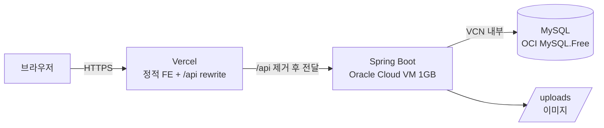
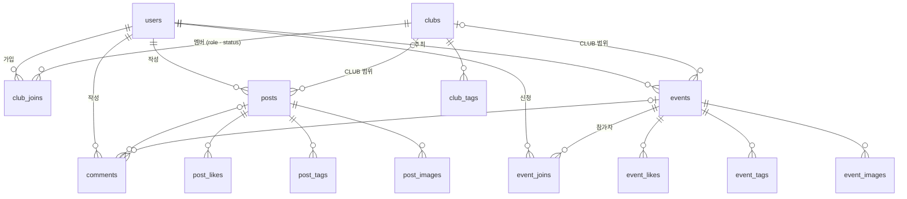

# 🕺 C.Groove - Dance Community Platform (BE)

> 대학 댄스동아리들을 하나로 잇는 커뮤니티 · 행사 신청 플랫폼의 백엔드

[](#-테스트)
[](#-테스트)
[](#-테스트)
[](https://openjdk.org/)
[](https://spring.io/)

- 서비스: https://cgroove.vercel.app
- 프론트엔드: [CGroove-FE](https://github.com/CGroove/CGroove-FE)
- 카카오테크 부트캠프 3기 개인 프로젝트 (2025.09 ~ 2025.12), 이후 운영 · 개선 중

---

## 💡 프로젝트 소개

대학 댄스 동아리 활동을 하며 가장 불편했던 점은 **흩어져 있는 정보**였습니다. 행사 신청은 구글 폼, 공지는 단톡방, 홍보는 인스타그램으로 나뉘어 있고, 동아리를 잇는 커뮤니티는 따로 없었습니다.

C.Groove는 동아리 · 크루를 만들고, 게시글을 전체 또는 동아리 안에만 공유하고, 워크숍 · 배틀 같은 행사에 선착순으로 신청할 수 있는 커뮤니티입니다. 부트캠프 주차 과제(REST API → JPA → 프론트엔드 → 인증)를 처음부터 이 주제로 이어가며 하나의 서비스로 발전시켰습니다.

## 🛠 Tech Stack

| 구분 | 기술 |
|---|---|
| Language · Framework | Java 21, Spring Boot 3.5.7 |
| Data | Spring Data JPA, QueryDSL 5, MySQL (운영) · H2 MySQL 모드 (테스트) |
| Auth | Spring Security, JWT (jjwt), BCrypt |
| Test | JUnit5, Mockito, Spring Security Test, JaCoCo |
| Docs · Monitoring | springdoc (Swagger UI, 로컬), Actuator, Prometheus · Grafana (로컬), k6 |
| Infra | Oracle Cloud Always Free VM · MySQL, Vercel (FE · API 프록시) |

## 🏗 아키텍처



브라우저는 Vercel과만 통신하고 `/api/*`는 Vercel이 백엔드로 넘겨줍니다. 프론트와 API가 같은 출처가 되어 Refresh Token 쿠키와 CORS를 단순하게 유지합니다.

## 📂 ERD

테이블 14개 (엔티티 9 + 태그 · 이미지 `@ElementCollection` 5)



- 회원-동아리 N:M은 `club_joins`에 역할(LEADER · MANAGER · MEMBER)과 가입 상태(PENDING → ACTIVE 등)를 함께 저장
- 신청 · 좋아요는 대리키 + `UNIQUE(회원, 대상)`으로 중복 차단
- 멤버 수 · 참가자 수는 컬럼 대신 `@Formula` 서브쿼리로 계산
- 회원 · 동아리 · 게시글 · 행사 · 댓글은 `@SQLDelete` + `@SQLRestriction` Soft Delete

## 🌟 주요 기능

| 도메인 | 기능 | API |
|---|---|---|
| 인증 · 회원 | 회원가입(프로필 이미지), 로그인, 토큰 재발급, 정보 · 비밀번호 수정, 탈퇴 | 10 |
| 동아리 | 생성 · 수정 · 삭제, **가입 신청 → 승인 · 거절**, 역할 변경, 추방 | 18 |
| 게시글 | 전체 · 동아리 전용 공개 범위, 이미지 · 태그, 좋아요 · 조회수, 인기글 | 8 |
| 행사 | 워크숍 · 배틀 · 잼 · 공연 등록, **정원 기반 선착순 신청**, 참가자 관리 | 13 |
| 댓글 | 게시글 · 행사 공용 댓글 | 4 |

전체 API 문서는 로컬 실행 후 [Swagger UI](http://localhost:8080/swagger-ui/index.html)에서 볼 수 있습니다 (운영에서는 비활성).

## 🔐 인증 · 권한

- **Access Token** (1시간): 응답 body로 전달, `Authorization: Bearer` 헤더로 사용
- **Refresh Token** (7일): `HttpOnly` 쿠키로만 전달해 스크립트에서 읽을 수 없게 함. Access Token이 만료되면 FE가 `/auth/refresh`로 재발급 후 원래 요청을 재시도
- **401 vs 403**: 인증 실패(토큰 없음 · 만료)는 401, 권한 부족(동아리 역할 · 작성자 · 주최자 아님)은 403. FE는 401일 때만 재발급 · 로그아웃을 시도
- **로그인 실패**: 없는 이메일과 틀린 비밀번호를 같은 401 · 같은 메시지로 응답해 가입 여부가 드러나지 않게 함
- 동아리 권한 검증은 `ClubAuthService` 한 곳에 모음 (LEADER · MANAGER / LEADER 전용)

## ⚡ 기술적 고민과 해결

### 1. 선착순 신청: 정원 초과를 막는 비관적 락
"확정 인원 조회 → 정원 비교 → 저장" 사이에 다른 요청이 끼어들면 정원을 넘길 수 있습니다. 행사 행을 `@Lock(PESSIMISTIC_WRITE)`로 먼저 잠그고 같은 트랜잭션에서 세고 저장합니다. 같은 회원의 중복 신청은 유니크 제약으로 막습니다.

| 정원 10 · 동시 50명 신청 (H2) | 결과 |
|---|---|
| 락 있음 | 42회 모두 정확히 10명 확정 |
| 락 제거 (비교용) | 25회 중 5회 정원 초과 (최대 14명) |

→ [`EventJoinConcurrencyTest`](cgroove/src/test/java/com/example/cgroove/concurrency/EventJoinConcurrencyTest.java)

### 2. 목록 조회 N+1: 쿼리 수를 직접 세어 확인
목록 API를 응답 직렬화까지 호출하고 Hibernate Statistics로 SQL 수를 셌습니다.

| 설정 | 10개 | 20개 |
|---|---|---|
| 둘 다 없음 | 44 | 84 |
| fetchJoin만 | 33 | 63 |
| batch fetch만 | 8 | 8 |
| **fetchJoin + batch fetch (현재)** | **6** | **6** |

N+1의 주원인은 작성자 · 동아리가 아니라 **태그 · 이미지 · 댓글 컬렉션**이었습니다. 단일 연관은 QueryDSL `fetchJoin`, 컬렉션은 `default_batch_fetch_size`로 나눠 목록 조회를 항목 수와 무관한 6쿼리로 고정했습니다. 항목이 늘면 쿼리 수가 늘지 않는지 테스트로 남겼습니다.

→ [`ListQueryCountTest`](cgroove/src/test/java/com/example/cgroove/performance/ListQueryCountTest.java)

### 3. 필터를 끈 테스트가 놓친 인증 버그
컨트롤러 테스트가 보안 필터를 끄고(`addFilters = false`) 실행돼, 재발급 API가 인증 필수 경로에 남아 **1시간마다 강제 로그아웃**되던 문제와 권한 부족이 401로 나가 **로그아웃으로 이어지던** 문제를 잡지 못했습니다. 필터를 켠 통합 테스트로 두 문제를 재현한 뒤 수정했고, 수정 전 코드에서는 이 테스트가 실패하는 것도 확인했습니다.

→ [`AuthFlowIntegrationTest`](cgroove/src/test/java/com/example/cgroove/integration/AuthFlowIntegrationTest.java)

### 4. 순환 참조 해소
`ClubService`와 `ClubJoinService`가 서로를 참조해 애플리케이션이 뜨지 않았습니다. 여러 서비스가 공통으로 필요로 하던 "동아리 조회 + 권한 검증"을 `ClubAuthService`로 분리해 단방향 의존으로 정리했습니다.

## 🧪 테스트

| 구분 | 수 | 방식 |
|---|---|---|
| Service | 134 | JUnit5 + Mockito |
| Controller | 59 | `@WebMvcTest` + MockMvc |
| Repository | 16 | `@DataJpaTest` (QueryDSL 커스텀 쿼리) |
| Security · Validation | 20 | JWT · 쿠키 · 검증기 |
| 통합 (보안 필터 ON) | 6 | `@SpringBootTest` 인증 흐름 · 행사 생성 |
| 동시성 · 쿼리 수 · 기동 | 4 | 위 1 · 2번 |

**239개 · 라인 94.1% · 브랜치 71.7%** (JaCoCo, dto · entity · config · exception · Q클래스 제외)

```bash
cd cgroove
./gradlew test jacocoTestReport
# 리포트: build/reports/jacoco/test/html/index.html
```

## 🚀 로컬 실행

**요구 사항**: JDK 21, MySQL 8 (`cgroove-db` 데이터베이스)

```bash
git clone https://github.com/CGroove/CGroove-BE.git
cd CGroove-BE/cgroove
./gradlew bootRun   # 기본 프로필: local (application-local.yml)
```

- 접속 정보: `jdbc:mysql://localhost:3306/cgroove-db`, 사용자 `root` — 다르면 `src/main/resources/application-local.yml` 수정
- 프론트엔드는 [CGroove-FE](https://github.com/CGroove/CGroove-FE)의 `npm run dev` (Vite가 `/api`를 `localhost:8080`으로 프록시)

## ☁️ 배포

`prod` 프로필은 모든 설정을 환경변수로 받습니다 (`DB_URL`, `DB_USERNAME`, `DB_PASSWORD`, `JWT_SECRET`, `CORS_ALLOWED_ORIGINS`, `FILE_UPLOAD_BASE_DIR`).

```bash
cd cgroove
./deploy.sh   # bootJar 빌드 → 서버 업로드 → systemd 재시작 → health 확인
```

- 서버: Oracle Cloud Always Free (1/8 OCPU · 1GB) — JVM 힙 448MB 제한, 운영 SQL 로깅(p6spy) 비활성
- 이력: 2025.12 AWS EC2 + RDS → 2026.09 Oracle Cloud로 이전

## 📁 프로젝트 구조

```
cgroove/src/main/java/com/example/cgroove
├── controller      # HTTP · @Valid · 응답 (8)
├── service         # 비즈니스 로직 · 권한 검증 · 트랜잭션 (12)
├── repository      # Spring Data JPA + QueryDSL custom/impl
├── entity · enums  # 도메인 모델
├── dto             # 요청 · 응답 (불변)
├── security        # JwtFilter · JwtUtil · CookieUtil
├── config          # Security · QueryDSL · Swagger · 파일 경로
├── exception       # 커스텀 예외 + GlobalExceptionHandler
└── validation      # 게시글 · 행사 공개 범위 검증
```

## 🗺 로드맵

- [x] 댓글, 비관적 락 선착순 신청, QueryDSL, 테스트 · JaCoCo
- [x] 배포 (AWS EC2 + RDS → Oracle Cloud)
- [x] 인증 버그 수정 (재발급 · 401/403 분리), 동시성 · 쿼리 수 테스트 (2026.09)
- [ ] 거절된 행사 신청의 재신청 차단, 동아리 전용 글 작성 · 조회 권한 검증
- [ ] 목록 API 페이지네이션, 댓글 수 조회 최적화
- [ ] Refresh Token 서버 저장 + Rotation, 쿠키 Secure · SameSite
- [ ] 404 · 405 예외 처리, 에러 응답 형식 통일
- [ ] CI (GitHub Actions), 운영 actuator · API 문서 노출 차단

## 👨‍💻 개발자

**남진** · GitHub [@baggytsk](https://github.com/baggytsk) · jinoj0423@gmail.com
